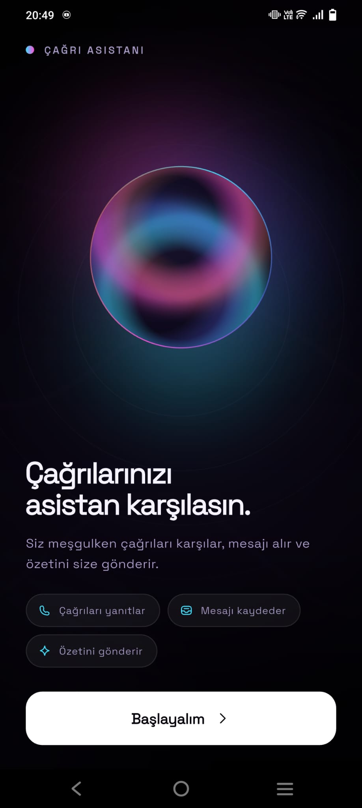
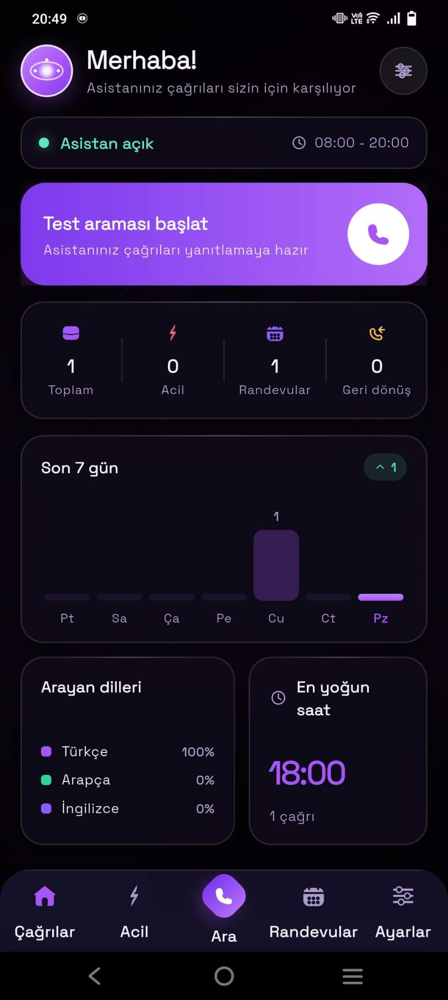
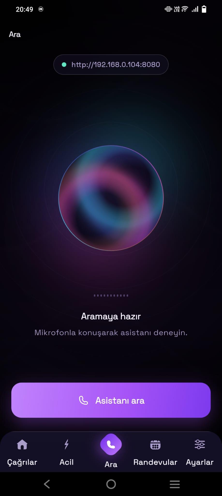
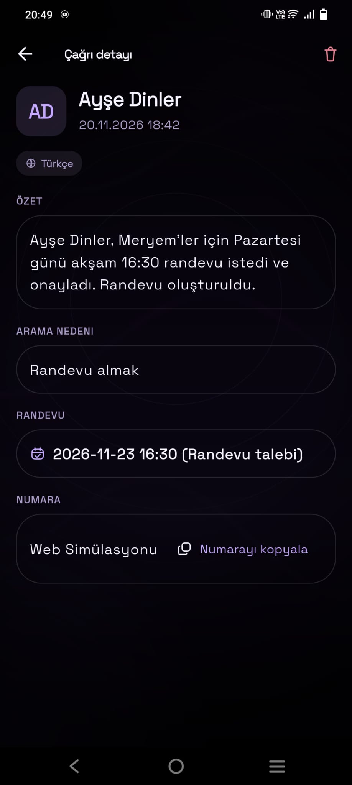
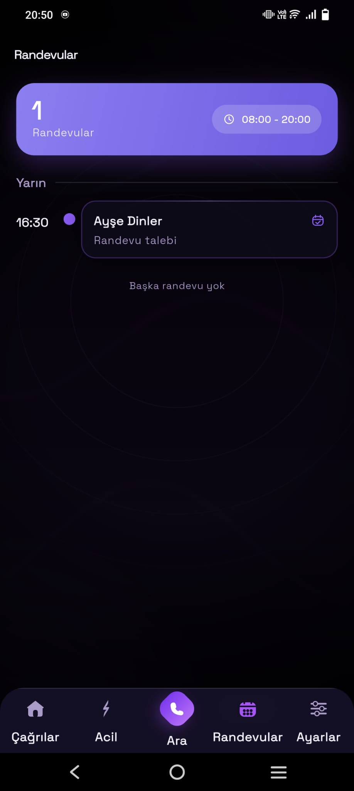
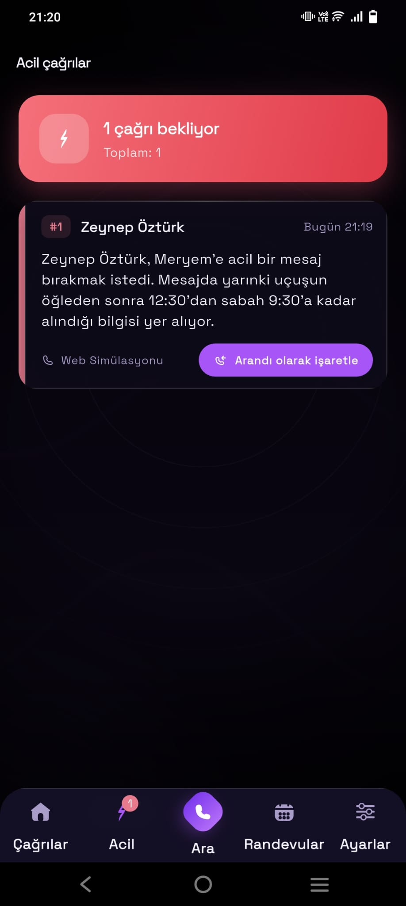
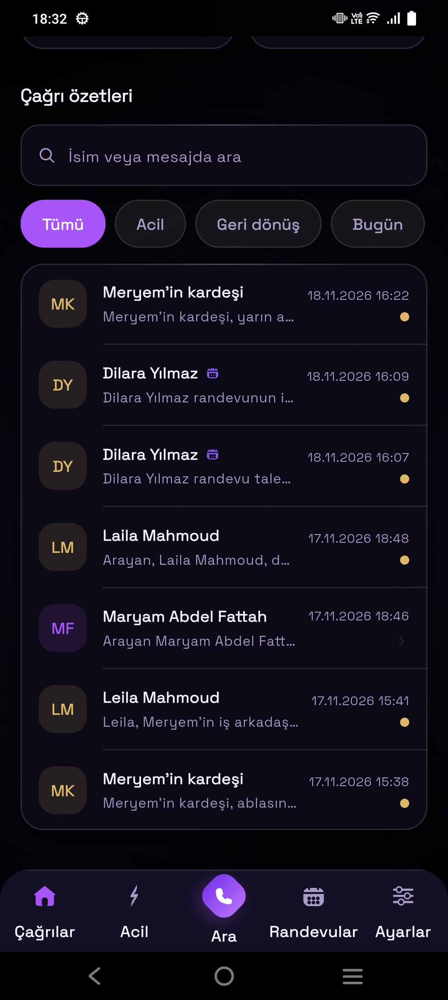
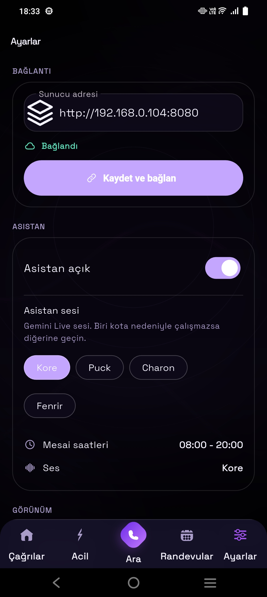

# AI Çağrı Asistanı

Telefonunuz açılmadığında çağrıyı karşılayan, arayanı **Türkçe, Arapça veya
İngilizce** dinleyen, mesajını alan, randevusunu Google Takvim'e yazan ve
görüşme biter bitmez size özetini gönderen bir sesli asistan.

Projede iki parça var: Python ile yazılmış **asistan servisi** ve Flutter ile
yazılmış **mobil panel**.

---

## Ekran görüntüleri

| Karşılama | Panel | Görüşme |
|---|---|---|
|  |  |  |

| Çağrı detayı | Randevular | Acil çağrılar |
|---|---|---|
|  |  |  |

| Çağrı özetleri | Ayarlar |
|---|---|
|  |  |

---

## Asistan ne yapıyor

**Dil** — Arayanın dilini konuşmadan algılar ve aynı dilde devam eder.
Arapçada lehçeleri (Mısır, Şam, Körfez) anlar, yanıtı Modern Standart
Arapça verir.

**Mesaj alma** — Arama nedenini ve mesajı alır, geri aranmak isteyip
istemediğini sorar, bilgileri tekrar edip onay aldıktan sonra kaydeder.
Numarası görünmeyen (web / VoIP) aramalarda geri arama isteniyorsa numarayı
bir kez sorar.

**Randevu** — Ad ve soyadı öğrenir, tarih ve saati netleştirir, müsaitliği
**Google Takvim**'den kontrol eder, arayandan açık onay aldıktan sonra
kaydı oluşturur. Belirsiz saatlerde ("saat üçte") sabah mı akşam mı diye
sorar ve 24 saatlik biçime çevirir. Mesai saatleri dışına randevu vermez.

**Randevu iptali** — Ad, soyad, tarih ve saatin üçünü de doğrulamadan iptal
etmez. Başka kişilerin randevu bilgilerini asla paylaşmaz.

**Arkadaş ve aile** — Arayan yakınlığını söylerse resmi davranmaz; mesai
saatlerinden ve takvimden hiç bahsetmez. Söylediği buluşma saatini randevu
değil, mesaj olarak iletir.

**Acil durum** — Hastane, kaza, ambulans gibi gerçek bir acil durumda kaydı
acil işaretler ve bildirim gönderir. Hayati tehlike varsa 112'yi aramasını
söyler.

**Gereksiz kayıt tutmaz** — Çalıp kapanan, sessiz kalan veya isimsiz ve
içeriksiz görüşmeler için kayıt oluşturulmaz.

**Kayıt izni** — Arayan görüşmenin kaydedilmesini istemediğini söylerse
mesaj ve arama nedeni **saklanmaz**; yalnızca adı ve geri arama talebi
tutulur. Bu durumda geri arama sorusu zorunludur, aksi halde arama hiçbir
iz bırakmadan kapanır.

**Onaysız kayıt olmaz** — Kayıt, arayan bilgileri tekrar dinleyip açıkça
onayladıktan sonra oluşturulur. Arayan onay vermeden kapatırsa kayıt silinmez
ama özet alanı `[Teyitsiz]` etiketiyle işaretlenir, böylece telefon sahibi
doğrulanmamış bir bilgiyi kesin bilgi gibi kullanmaz.

**Aynı çağrı iki kez kaydedilmez** — Görüşme sırasında kayıt aracı başarıyla
çalıştıysa kapanıştaki otomatik özet devreye girmez; her çağrı için tek kayıt
oluşur.

**Bilgi uydurmaz** — Fiyat, ücret, adres veya süre gibi konuşulmamış hiçbir
ayrıntıyı kendiliğinden söylemez.

---

## Mimari

```
Arayan ──> (Bulut SIP numarası) ──> LiveKit Server ──> Asistan (agent.py)
                                                          │
                                   ┌──────────────────────┼──────────────────────┐
                                   │                      │                      │
                             Gemini Live            Google Takvim           Firebase
                          (ses + anlama)        (randevu aç/iptal)      (çağrı özetleri)
                                                                                 │
                                                                        Flutter mobil panel
```

### Neden Realtime

İki mimari de kuruldu ve aynı senaryolarla ölçüldü:

| Mimari | Ortalama yanıt süresi |
|---|---|
| Cascade (Whisper → LLM → TTS) | **4.597 ms** |
| Realtime (Gemini Live) | **1.370 ms** |

Telefonda bu fark doğrudan hissediliyor. Ayrıca Cascade'de Arapça ses için
ElevenLabs'e ayrıca ödeme gerekiyordu; Realtime'da bu kalem ortadan kalkıyor.
Realtime lehçeleri de daha iyi anlıyor ve telaffuzu daha doğal.

Cascade kodu yedek olarak projede duruyor (`agent_config.json` içindeki
`architecture` alanı `cascade` yapılarak açılır).

### Entegrasyonlar

| Servis | Ne için | Dosya |
|---|---|---|
| **LiveKit** | Ses akışı ve oda yönetimi | `livekit.yaml`, `docker-compose.yml` |
| **Gemini Live** | Konuşma anlama ve yanıt üretme | `agent.py` |
| **Google Takvim** | Randevu açma, iptal, müsaitlik kontrolü | `services.py` |
| **Firebase Firestore** | Çağrı özetlerinin kalıcı kaydı | `services.py` |
| **ntfy.sh** | Telefona anlık bildirim | `services.py` |
| **Groq** | Cascade mimarisi (yedek) | `agent.py` |
| **ElevenLabs** | Cascade'de Arapça ses (isteğe bağlı) | `piper_tts_plugin.py` |

---

## Gerçek bir numaraya bağlama

Proje **bulut numarasına bağlanmaya hazır** durumda. Şu an yerel ortamda
`web_dialer.py` üzerinden simüle edilen çağrı akışı, gerçek bir numarada
hiçbir kod değişikliği gerektirmez; yalnızca SIP yapılandırması eklenir.

Yapılacaklar:

1. Bir SIP sağlayıcısından numara alın (Twilio, Telnyx veya yerel bir operatör).
2. `setup_sip.py` içindeki trunk bilgilerini sağlayıcınızın değerleriyle doldurun.
3. LiveKit SIP servisini çalıştırın (`docker-compose.yml` içinde hazır).
4. Telefonunuzda **koşullu çağrı yönlendirme** tanımlayın: açılmayan çağrılar
   bu numaraya gitsin.

Bu adımdan sonra asistan gerçek çağrıları karşılamaya başlar. Mobil panel,
takvim ve veritabanı tarafında değişiklik gerekmez.

---

## Güvenlik

Bu projede uygulanmış olan korumalar:

**API belirteci** — `/logs`, `/api/config` ve `/token` uç noktaları `.env`
içindeki `API_TOKEN` olmadan yanıt vermez. Belirteç, mobil uygulamada
**Ayarlar → Sunucu belirteci** alanından, web panelinde ise ilk açılışta bir
kez girilir. Yanlış veya eksik belirteçte sunucu `401` döner.

> Bu koruma eklenmeden önce aynı ağdaki herkes çağrı özetlerini okuyabiliyor,
> silebiliyor ve asistanın ayarlarını değiştirebiliyordu.

**LiveKit anahtarları** — Varsayılan `devkey` / `secret` çifti herkesin
bildiği örnek değerlerdir; bunlarla herhangi biri geçerli bir token üretip
görüşmelere katılabilir. Projede rastgele üretilmiş anahtarlar kullanılır ve
`.env`, `livekit.yaml` ile `lan_bridge.py` aynı değerleri okur.

```bash
python -c "import secrets; print(secrets.token_urlsafe(32))"
```

`livekit.yaml` gerçek anahtarları içerdiği için depoya yüklenmez. Depoyu
klonladıktan sonra örnek dosyayı kopyalayıp kendi anahtarlarınızı yazın:

```bash
copy livekit.example.yaml livekit.yaml    # Windows
# cp livekit.example.yaml livekit.yaml    # Linux / macOS
```

**Firestore kuralları** — Veritabanına tüm istemci erişimi kapalıdır:

```
match /{document=**} {
  allow read, write: if false;
}
```

Sunucu, Admin SDK (servis hesabı) ile bağlandığı için bu kuraldan etkilenmez.
Mobil uygulama Firestore'a doğrudan bağlanmaz; verileri `web_dialer.py`
üzerinden alır. Firebase'in kurulumda önerdiği test kuralı
(`allow read, write: if true`) veritabanını herkese açar ve kullanılmamalıdır.

**Sırlar depoya girmez** — `.env`, servis hesabı JSON dosyaları, çağrı
kayıtları ve üretilen APK'lar `.gitignore` ile dışarıda tutulur. Depoda yalnızca
değer içermeyen `.env.example` bulunur.

**Asistan tarafındaki korumalar** — Randevu yalnızca arayanın açık onayıyla
açılır; iptal için ad, soyad, tarih ve saatin dördü de doğrulanır; başka
kişilerin randevu bilgileri paylaşılmaz; fiyat, adres ya da süre gibi
konuşulmamış hiçbir bilgi uydurulmaz; çalıp kapanan veya isimsiz ve içeriksiz
görüşmeler kayıt oluşturmaz.

---

## Yayına almadan önce yapılması gerekenler

Proje şu anda **çalışan bir prototiptir**: tek bir bilgisayarda, yerel ağda
çalışır. Gerçek kullanıcıların aradığı bir hizmete dönüşmesi için aşağıdakiler
tamamlanmalıdır.

### Zorunlu

| Konu | Durum | Yapılacak |
|---|---|---|
| **Kimlik doğrulama** | Yok | Panelde kullanıcı girişi; şu an belirteci bilen herkes tüm kayıtları görür |
| **HTTPS** | Yok | Sunucu `http://` üzerinden çalışıyor; sertifika ve alan adı gerekir |
| **Barındırma** | Yok | Sunucu bir bilgisayarda; bulut sunucuya taşınmalı |
| **Gizlilik politikası** | Yok | Yazılı metin, saklama süresi ve silme talebi akışı (aşağıya bakınız) |
| **Veri saklama süresi** | Yok | Kayıtlar süresiz birikiyor; otomatik silme eklenmeli |
| **İstek sınırı** | Yok | Uç noktalarda hız sınırı yok |
| **Yedekleme** | Yok | Firestore ve yapılandırma için düzenli yedek |

### Gizlilik ve KVKK

Asistan **telefon görüşmelerini kaydedip metne çeviriyor**; bu, üçüncü
kişilere ait kişisel veridir. Türkiye'de KVKK, Avrupa'da GDPR kapsamına girer.

Mevcut durum: asistan karşılama cümlesinde *"Görüşmemiz kaydedilmektedir"*
diyerek **bilgilendirme yapıyor**. Bu doğru bir adımdır ancak tek başına
yeterli değildir.

Eksikler:

1. **Yazılı politika** — hangi verinin, hangi amaçla, nerede, ne kadar süreyle
   tutulduğunu ve hangi üçüncü taraflara (Google Gemini, Google Takvim,
   Firebase) aktarıldığını açıklayan bir metin.
2. **Saklama süresi** — belirlenmiş bir süre (örneğin 90 gün) ve bu sürenin
   sonunda kayıtları otomatik silen bir görev.
3. **Silme talebi** — arayanın kendi kaydının silinmesini isteyebilmesi ve bu
   talebin işletilebilmesi.

Bu üçü tamamlanmadan hizmet gerçek çağrı almamalıdır.

Tamamlanan madde: **kayıt reddi hakkı**. Arayan kaydedilmek istemediğini
söylediğinde görüşme içeriği artık hiç saklanmıyor (bkz. *Asistan ne
yapıyor → Kayıt izni*); yalnızca geri arama talebi tutuluyor. Böylece
bilgilendirme tek yönlü bir duyuru olmaktan çıkıp arayanın gerçekten
reddedebileceği bir seçeneğe dönüşüyor.

### Önerilen

Yapılandırılmış ve merkezî günlük kaydı, hata ve kesinti bildirimleri,
yetki seviyeleri (okuma / yönetim) ve bildirim e-postaları.

---

## Kurulum

### Gereksinimler

- Python 3.12
- Docker (WSL2 üzerinde çalışabilir)
- Flutter 3.27+ ve Android SDK (mobil panel için)

### 1. Depoyu klonlayın

```bash
git clone https://github.com/MariamAbdelghanie/ai-call-assistant.git
cd ai-call-assistant
```

### 2. Python ortamı

```bash
python -m venv .venv
.venv\Scripts\activate        # Windows
# source .venv/bin/activate   # Linux / macOS
pip install -r requirements.txt
```

### 3. Anahtarlar

`.env.example` dosyasını `.env` olarak kopyalayın ve kendi anahtarlarınızı yazın:

```bash
copy .env.example .env        # Windows
# cp .env.example .env        # Linux / macOS
```

Gerekli anahtarlar ve nereden alınacakları:

| Değişken | Nereden |
|---|---|
| `GOOGLE_API_KEY` | https://aistudio.google.com/apikey (Gemini Live) |
| `GROQ_API_KEY` | https://console.groq.com/keys (yalnızca Cascade için) |
| `GOOGLE_CALENDAR_ID` | Takvimini kullanacağınız Google hesabının e-postası |
| `NTFY_TOPIC` | Tahmin edilemeyecek rastgele bir isim seçin |
| `ELEVENLABS_API_KEY` | https://elevenlabs.io (isteğe bağlı) |
| `API_TOKEN` | Rastgele üretin; panel ve mobil uygulama bu değerle bağlanır |
| `LIVEKIT_API_KEY` / `LIVEKIT_API_SECRET` | Rastgele üretin; `livekit.yaml` ile aynı olmalı |

> Bu depoda hiçbir gerçek anahtar bulunmaz. `.env`, servis hesabı JSON
> dosyaları ve çağrı kayıtları `.gitignore` ile dışarıda tutulur.

### 4. Google servis hesapları

Google Cloud Console'da bir proje açıp **Calendar API**'yi etkinleştirin ve
OAuth istemci dosyasını `credentials.json` adıyla proje köküne koyun.

Firebase Console'da bir proje açıp **Firestore**'u etkinleştirin, servis
hesabı anahtarını `firebase-credentials.json` adıyla proje köküne koyun.

### 5. LiveKit

```bash
copy livekit.example.yaml livekit.yaml    # Windows
# cp livekit.example.yaml livekit.yaml    # Linux / macOS
```

`livekit.yaml` içindeki `keys` bölümünü `.env` dosyasındaki
`LIVEKIT_API_KEY` ve `LIVEKIT_API_SECRET` ile aynı yapın, sonra:

```bash
docker compose up -d
```

### 6. Çalıştırma

Üç ayrı terminalde:

```bash
python lan_bridge.py       # LiveKit portlarını yerel ağa köprüler
python web_dialer.py       # http://localhost:8080 — test arayüzü ve REST API
python agent.py dev        # asistan
```

`agent.py` penceresinde `registered worker` satırını görünce asistan hazırdır.
Tarayıcıdan `http://localhost:8080` açıp mikrofonla konuşarak deneyebilirsiniz.

### 7. Mobil panel

```bash
cd mobile
flutter pub get
flutter run
```

Uygulama açıldığında **Ayarlar → Sunucu adresi** alanına bilgisayarınızın
yerel IP adresini yazın:

```
http://192.168.1.x:8080
```

Hemen altındaki **Sunucu belirteci** alanına `.env` dosyasındaki `API_TOKEN`
değerini yazın; bu alan boş bırakılırsa sunucu `401` döner.

(IP adresini `ipconfig` veya `ifconfig` ile öğrenebilirsiniz. Telefon ve
bilgisayar aynı Wi-Fi ağında olmalı. `Bağlandı` yazısını görmelisiniz.)

APK üretmek için:

```bash
flutter build apk --release
```

---

## Proje yapısı

```
agent.py                 Asistan: diyalog kuralları, araçlar, çağrı akışı
agent_brain/             Kayıt doğrulama sözleşmesi (eksik kayıt kabul edilmez)
services.py              Google Takvim, Firebase ve bildirim entegrasyonları
web_dialer.py            Test arayüzü + mobil panelin kullandığı REST API
lan_bridge.py            LiveKit portlarını WSL'den yerel ağa köprüler
piper_tts_plugin.py      Cascade mimarisi için ses sentezi
config_validation.py     Açılışta yapılandırma denetimi
latency_logger.py        Yanıt süresi ölçümü
livekit.yaml             LiveKit sunucu yapılandırması
docker-compose.yml       LiveKit + Redis + SIP servisleri
mobile/                  Flutter mobil panel
docs/screenshots/        Ekran görüntüleri
```

---

## Sorun giderme

**`agent.py` → `Cannot connect to host 127.0.0.1:7880`**
LiveKit çalışmıyor veya köprü kapalı. Önce Docker'ı, sonra `lan_bridge.py`'yi,
en son `agent.py`'yi başlatın.

**Asistan karşılıyor ama yanıt vermiyor**
Aynı anda birden fazla `agent.py` çalışıyor olabilir. Gemini Live ücretsiz
katmanı tek oturuma izin verir; ikinci oturum `409 Conflict` ile reddedilir.
Tüm pencereleri kapatıp tek bir tane açın.

**Telefon sunucuya bağlanamıyor**
Telefon ve bilgisayar aynı ağda mı, güvenlik duvarı 8080 portuna izin veriyor
mu kontrol edin (`open_firewall.ps1`). Kurumsal ve üniversite ağları cihazlar
arası iletişimi engeller; böyle bir ağda yerel bağlantı çalışmaz.

---

## Durum

Asistan ve mobil panel çalışır durumda ve proje **gerçek bir bulut numarasına
bağlanmaya hazırdır**; akış kod değişikliği gerektirmeden çalışır, yalnızca SIP
yapılandırması eklenir (bkz. *Gerçek bir numaraya bağlama*).

Numara bağlanmadan önce *Yayına almadan önce yapılması gerekenler* bölümündeki
zorunlu maddelerin, özellikle gizlilik politikası ve veri saklama süresinin
tamamlanması gerekir.
